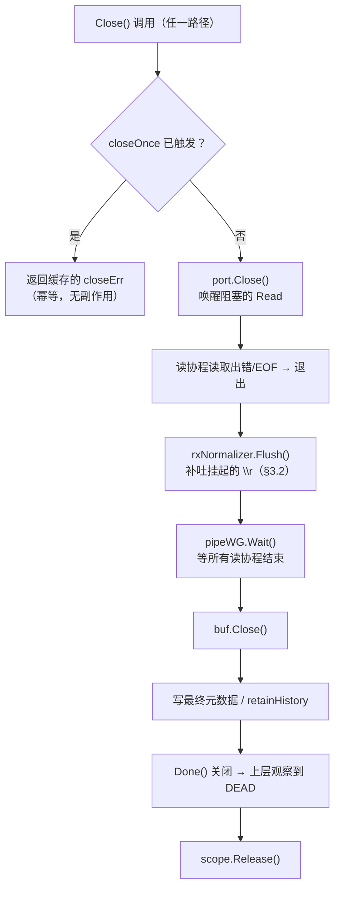
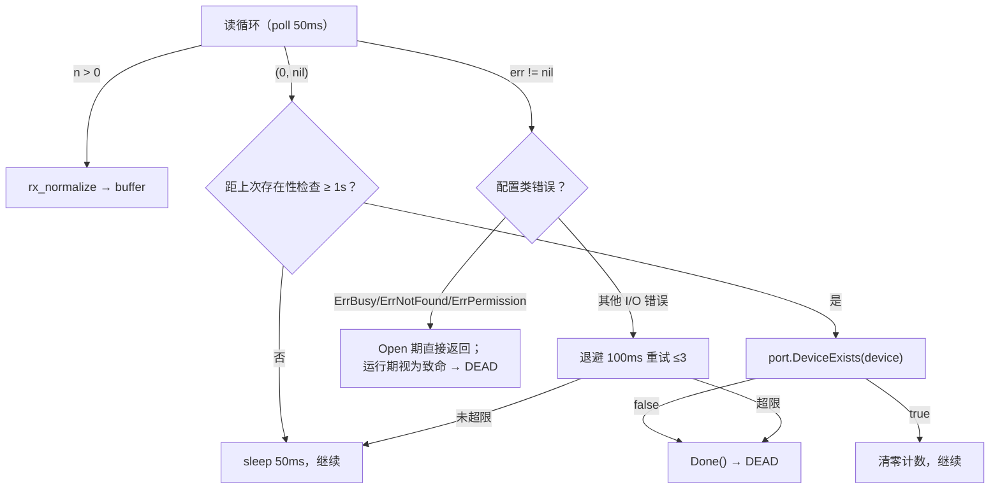

# 串口（Serial）连接能力设计规格

- 日期：2026-10-02
- 修订：2026-10-02（v3）
- 分支：`feature/serial`
- 状态：**v3 已纳入第二轮评审意见，待第三轮确认后实施**
- 本轮变更摘要：容器层 `transport` 抽象（P0-1）· 关闭语义与幂等（P0-2）·
  审批定性（P0-3）· 读取可中断（P1-1）· `rxNormalizer.Flush`（P1-2）·
  占用原子化（P1-4）· `encoding` 出口统一（P1-5）· 能力解耦（P1-6）· 联合校验（P1-7）
- 未采纳项见 §0.3（附理由）

## 〇、修订历史与评审意见处置（必读）

本文档经过两轮评审。**两份评审意见的处置逐条列在 §0.3**，
包括**未采纳项及其理由**——这样评审链可追溯，避免同一问题在下一轮被重复提出。

### 0.1 v1 → v2：修正接口抽取的层次

v1 的核心缺陷：**接口抽取加错了层**。v1 假设 `Session` 直接持有并调用
`execSession.*`，并据此提出 `session.Transport` 接口。实际代码不是这样。

| 结构体 | 角色 | `execSession` 字段 | 真实调用点 |
|---|---|---|---|
| `Session` (`:78`) | 连接容器 | `:87` | **4 处**（`:485`/`:576`/`:643`/`:754`，见 §2.1 不变量与 §2.4） |
| `ChildShell` (`:780`) | shell 通道 | `:784` | **11 处**（见 §2.2 表） |

v1 声称"`execSession.*` 共 15 处，11 处改为接口调用"——**数字对不上，且归属错了**：
那 11+ 处几乎全在 `ChildShell` 上，不在 `Session` 上。

这不是笔误。仓库在 `session.go:773-779`（`ChildShell` 的类型注释）有一条
**刻意写下**的架构说明：

> A session is a connection container, and every read or write of terminal bytes
> goes to one of its shell channels. The dead `TerminalShell` interface used to
> suggest a `*Session` could stand in for one; nothing ever did that, and
> widening it back would reopen a second write path around the approval gate.

即：**项目此前抽过一次这个接口（`TerminalShell`），并因为"它会绕过审批门"而刻意删除。**

**v2 修正**：串口会话的**通道层**复用 `ChildShell`，把 `ChildShell.execSession`
换成窄接口 `shellChannel`（§2.2）。

### 0.2 v2 → v3：修正容器层的类型矛盾（第二轮评审 P0-1）

**v2 存在一个硬矛盾，评审指出得正确。** v2 §2.1 同时规定：

```go
execSession *sshclient.ExecSession   // Session 层保持具体类型（v2 写法）
```

又规定串口的同一个 `serial.Channel` 被 `Session` 与 root `ChildShell` 共同引用。
**`serial.Channel` 无法赋值给 `*sshclient.ExecSession`——这是编译期就过不了的。**

v2 只给出了**通道层**的接口方案（`shellChannel`），**没有给出容器层的方案**。
`Session` 的 4 个调用点里，v2 只讨论了 `:485`（`Signal`）与 `:754`（`SSHClient()`），
而 `finalize`/`Disconnect` 两处 `Close()` 只列了行号、没有下文。

**v3 修正**：新增 §2.4 容器传输抽象，`Session` 增加 `transport` 字段承载
全会话共有的生命周期能力，`execSession` 退化为 SSH 专属字段。

#### 本轮一并发现的既有问题（两份评审均未提及）

`Terminate` 在 `session.go:504-508` 有一处**按 `SSHEndpoint` 字符串分支**：

```go
if s.SSHEndpoint == "internal" {
    es.Close()
} else {
    es.CloseSessionOnly()
}
```

串口会话 `SSHEndpoint` 为空，会走 `else` 分支。语义上串口两者等价（§2.5），
**碰巧正确**——但这与 §6.2 批评的"`shell_open` 靠 nil 判断拦住"是**同一类问题**：
靠巧合成立的分支。v3 一并显式化（§2.5）。

### 0.3 第二轮评审意见处置表

评审共 3 条 P0 + 7 条 P1。处置如下：

| 编号 | 评审主张 | 处置 | 说明 |
|---|---|---|---|
| **P0-1** | `Session.execSession` 类型与串口接入矛盾；建议加 `sessionTransport` | ✅ **采纳（核心）** | v2 确实存在该矛盾。采纳 `transport` 字段方案，但**修正其 `signaler` 设计**，见下 |
| **P0-1 附** | `signaler interface { Signal(signal string) error }` | ⚠️ **部分修正** | 实际签名是 `Signal(sig ssh.Signal) error`（`client.go:312`）。写成 `string` 要么把 ssh 类型留在通用接口里，要么需转换层。**`Signal` 是 SSH 专属概念，应移出必需接口，改为可选能力探测**（与 `ptyResizer` 同构）。理由见 §2.4 |
| **P0-2** | 三个关闭入口语义需统一；串口关闭需幂等；读协程退出后才能释放 | ✅ **采纳** | 已核实 `Disconnect:643`、`finalize:576`、root `TerminateShell:1124` 三条路径触碰同一对象。新增 §2.6 关闭语义表 + 幂等要求 |
| **P0-3** | 串口输入必须与审批共享同一写入路径 | ✅ **采纳（限定范围）** | 但**评审对 Web UI 的描述与代码冲突**，见下 |
| **P0-3 附** | "Web UI 的人工输入…仍经过现有写入序列化机制" | ❌ **该项不采纳** | `webui/ws.go:214-226` 有**刻意设计**的注释：review mode 不 gate Web UI 路径，因为"the gate exists to review what the AI sends"；gate 住会"lock the operator out of their own terminal"。**Web UI 走的是 `stdinMu` 串行化（正确），但不走审批（也是正确）**。串口不得改变这一点 |
| **P0-3 有效增量** | DTR/RTS/Break 需明确权限与审计策略 | ✅ **采纳** | 这是真实缺口：v2 §6.1 只列了 `serial_ctl` 动作，**未规定审批策略**。而复位/进 Bootloader 比普通输入更危险。新增 §6.5 |
| **P1-1** | 读取必须真正可中断，不能只靠轮询；`(0,nil)` 不得忙循环 | ✅ **采纳** | 已核实 `pipeToBuffer`（`:1161-1228`）**无 `(0,nil)` 守卫**，循环仅在 `err != nil` 退出——串口返回 `(0,nil)` 会**空转烧 CPU**。v2 仅在 §4 脚注提及，v3 提为硬性要求 + 单测 |
| **P1-2** | `rx_normalize` 跨读边界需完整定义 | ✅ **采纳（1 条新增）** | 评审列 7 项，v2 §9.1 已覆盖 6 项。**新增第 7 项确为缺口**：流结束时挂起的 `\r` **必须 flush**，否则丢最后一个字符 |
| **P1-3** | `tx_eol=none` 命名歧义，建议改 `raw_cr` | ⚠️ **采纳语义，不采纳改名** | 歧义属实。但改名是破坏性变更且 `none` 语义（"原样发裸 `\r`"）无明显错误。**采纳方式**：保留 `none`，强制在 profile 文档 / MCP 工具描述 / Web UI **统一解释**（§3.2、§6.1、§8） |
| **P1-4** | 端口独占不能只靠路径规范化（TOCTOU 竞态等） | ✅ **采纳** | 三点均有效。v2 §5 只做静态 `CanonicalDevice()` 比较，**未处理"检查→打开"之间的竞态**。新增 §5.2 |
| **P1-5** | encoding 必须在所有输出出口统一生效 | ✅ **采纳（结论），⚠️ 修正描述** | 评审说"内部读取层优先使用 `[]byte`"——**实际 `buffer.Read` 已返回 `[]byte`**（`buffer.go:153`），转换发生在更上层。**但其核心担忧成立**：有 **4 个出口**做 `string()` 转换，`EncodeText` 目前**仅 sftp 使用**。新增 §3.2 `encoding` 出口约定 |
| **P1-6** | `serial_ctl` 能力需与 `shellChannel` 解耦 | ✅ **采纳** | 与 v2 §2.2 的 `ptyResizer` 可选能力探测同构，方向一致。写入 §6.5 |
| **P1-7** | Profile 路径与配置验证需收紧 | ⚠️ **部分采纳** | 白名单、严格解码、跨目录查重 v2 §3.3-§3.5 已有。**有效增量**：`serial_config(update)` 未传字段语义须明确；参数须**联合校验**（非逐字段）；`port.Open()` 归一化平台不支持组合。写入 §3.3、§6.1 |

---

## 一、目标与范围

### 1.1 目标

在 Termcp 现有 SSH 连接能力之上，增加**串口（serial）配置与连接**，把串口设备纳入既有的
session / shell 模型，使嵌入式设备调试（AT 命令、MCU 控制台）可以复用现有的全部工具面。

**核心用例**：嵌入式设备调试（AT/控制台），文本交互为主。

### 1.2 范围内

- 串口 profile 的存储、校验、增删改查
- 串口设备枚举
- 串口作为 Session（连接容器）+ 单 shell 通道接入
- 串口独占检测、设备丢失检测
- MCP 工具面扩展、Web UI 支持
- 跨平台（Linux / macOS / Windows），`CGO_ENABLED=0`

### 1.3 范围外

- **流控**（rtscts / dsrdtr / xonxoff）：所选串口库不支持，见 §2.8
- **自动重连**：不做。重连 = 用同一 entry 开新会话
- **rs485 硬件模式**：不属于流控，不在本设计范围
- 二进制协议（Modbus 等）的一等支持：字节流可承载，但 `encoding` 只做呈现，不做协议解析

### 1.4 关键设计约束

1. **`CGO_ENABLED=0`** 铁律不得破坏（Termcp 现有跨平台策略）
2. 串口**不开放任意 device 参数**给 `session_start`——只能通过 profile 连接
3. 现有 SSH 行为**零回归**；**不得重新引入 `TerminalShell` 式的跨层抽象**

---

## 二、架构

### 2.1 分层模型（v3）

复用现有两层结构，不新建平行的第三层。**两层各有自己的接口**：

```
Session（连接容器）              ← 串口会话 = Kind "serial"
  ├── execSession : *sshclient.ExecSession  (SSH 专属，串口为 nil)
  ├── transport   : transport               ← 【v3 新增】容器级生命周期
  └── shells map[string]*ChildShell
        ├── root ChildShell    ← session_start 创建的唯一/首个通道
        └── (串口会话永远只有这一个)
              └── execSession : shellChannel  ← 【v2】通道级字节流
```

**为什么容器层需要独立抽象（v3 核心修正）**

v2 只给了通道层的接口，`Session` 仍写死 `*sshclient.ExecSession`。
但 `serial.Channel` 不能赋给该类型——**编译期即失败**。而 `Session` 的 4 个
调用点全部是**容器级**操作（`Signal` / `Close` / `SSHClient()`），串口必须
各有一条路径。

**关键点**：`Session.execSession` 与 root `ChildShell.execSession` 在 SSH 下是
**同一个对象**（`session.go:217`、`:243` 由同一局部变量赋值）。串口同样如此：
一个 `serial.Channel` 同时满足 `transport`（给容器）与 `shellChannel`（给 root shell），
而 `Session.execSession` **保持 nil**。

> **不变量**：`Session.execSession != nil` ⟺ 该会话使用 SSH 传输。
> 串口会话的它恒为 nil；任何解引用前必须判空（现有 `:486`、`:575`、`:642`、
> `:751` 已有判空，方向正确）。

### 2.2 通道层接口：`shellChannel`（`internal/session/channel.go` 新建）

```go
// shellChannel is the byte-stream seam between a ChildShell and its transport.
//
// It is deliberately narrow and deliberately NOT named after Session: the
// project removed an earlier TerminalShell interface because it let a *Session
// stand in for a shell channel, which would reopen a second write path around
// the approval gate. This interface only ever describes one channel's stream.
type shellChannel interface {
	WriteStdin([]byte) (int, error)
	StdoutReader() io.Reader
	StderrReader() io.Reader
	Done() <-chan struct{}
	ExitCode() int
	Aborted() bool
	CloseReaders()
	CloseSessionOnly() error
	Close() error
}

// ptyResizer is an optional capability probed by type assertion.
// SSH satisfies it; serial does not (ErrUnsupported at the call site).
type ptyResizer interface {
	ResizePty(rows, cols int) error
}
```

`sshclient.ExecSession` 只需**追加两个只读访问器**，不改任何现有逻辑：

```go
func (es *ExecSession) StdoutReader() io.Reader { return es.Stdout }
func (es *ExecSession) StderrReader() io.Reader { return es.Stderr }
```

**`SSHClient()` 不进 `shellChannel`**。理由：它只服务 sftp / forward，属于
**容器级**能力而非通道级。串口的调用点在容器层拦截（见 §6.3），不靠通道接口。

**编译期断言**（放进 `internal/session` 或 `sshclient`）：

```go
var _ shellChannel = (*sshclient.ExecSession)(nil)
var _ ptyResizer   = (*sshclient.ExecSession)(nil)
```

#### `ChildShell.execSession` 调用点（11 处）

| # | 行 | 调用 | 处理 |
|---|---|---|---|
| 1 | `:901` | `WriteStdin` | 接口方法 |
| 2 | `:1008` | `WriteStdin` | 接口方法 |
| 3 | `:1028` | `ResizePty` | 断言 `ptyResizer`，失败 `ErrUnsupported` |
| 4 | `:1124` | `CloseSessionOnly` | 接口方法（串口幂等，§2.6） |
| 5 | `:1126` | `Done` | 接口方法 |
| 6 | `:1245` | `CloseReaders` | 接口方法 |
| 7 | `:1285` | `Stdout` → `StdoutReader()` | 改用访问器 |
| 8 | `:1286` | `Stderr` → `StderrReader()` | 改用访问器 |
| 9 | `:1295` | `Done` | 接口方法 |
| 10 | `:1299` | `ExitCode` | 接口方法（串口恒 -1） |
| 11 | `:1339` | `Aborted` | 接口方法（设备丢失 → true） |

### 2.3 v3 修正：为什么两处 SSH 专属分支必须显式化

现有代码里有**两处**容器层按字符串/指针判断的分支，串口会**碰巧**走对：

| 位置 | 现有代码 | 串口为何碰巧正确 | 风险 |
|---|---|---|---|
| `session.go:504-508` | `if s.SSHEndpoint == "internal" { es.Close() } else { es.CloseSessionOnly() }` | 串口两者语义等价（§2.5），走 `else` 也对 | 语义靠巧合；将来加第三种传输即失效 |
| `session.go:1365-1367` | `sshClient == nil` → 报 loopback 文案 | nil 判断拦住 `shell_open` | 报错误文案（§6.2） |

**v3 规定**：这两处都改为**显式按 `Kind` 分派**，不依赖字符串或 nil 巧合。
理由与本项目删除 `TerminalShell` 的动机一致——**隐式契约会在下次改动时静默失效**。

### 2.4 容器层接口：`transport`（v3 新增，`internal/session/transport.go`）

```go
// transport carries the lifecycle capabilities EVERY session needs,
// regardless of what carries the bytes. It deliberately excludes Signal:
// signalling a process is SSH-only (serial has no such concept), so it is
// probed separately as an optional capability below.
type transport interface {
	// Close releases the transport and any resources it owns. MUST be
	// idempotent: Disconnect, finalize, and the root shell's TerminateShell
	// can all reach it, and serial.Port.Close is not safe to call twice.
	Close() error

	// CloseSessionOnly closes this session's channel without tearing down a
	// shared connection. For serial it is equivalent to Close.
	CloseSessionOnly() error

	// Done closes when the transport is finished (process exit, port close,
	// read failure, device loss).
	Done() <-chan struct{}
}

// signaler is an OPTIONAL capability, probed by type assertion like ptyResizer.
// SSH satisfies it; serial does not, and Terminate takes its force-close path.
//
// The signature keeps ssh.Signal: it is only ever implemented by the SSH
// transport, so the import stays contained and no widening is needed. (An
// earlier review proposed Signal(string); that would either drag ssh types
// into the generic interface or invent a translation layer for a capability
// only one transport has.)
type signaler interface {
	Signal(sig ssh.Signal) error
}
```

**`Signal` 为何是可选能力而非 `transport` 的方法**

评审建议 `transport` 直接含 `Signal`。**不采纳**，理由：

1. **语义不存在**：串口没有信号概念。让 `serial.Channel` 实现一个
   `Signal(string) error` 只能返回 `ErrUnsupported`，这是**接口污染**——
   正是本项目删除 `TerminalShell` 时批评的那种"为了让签名统一而假装支持"。
2. **类型要么泄漏要么失真**：真实签名是 `Signal(sig ssh.Signal) error`。
   写成 `string` 需要在某处转换，而 `ssh.Signal` 只有
   `ssh.SIGTERM` 一个使用点（`session.go:492`），转换层没有第二个消费者。
3. **已有同构先例**：`ptyResizer` 就是这样处理的（SSH 满足，串口不满足）。
   `signaler` 与它完全同构，保持一致。

**`Terminate` 的改造**（`:485-509`）：

```go
tr := s.transport              // v3 新增：所有会话共有（SSH 与串口都设置）
if tr == nil {
    s.markDead()               // restored placeholder（无活动传输）
    return
}
if !force {
    if sg, ok := tr.(signaler); ok {   // 仅 SSH 满足
        _ = sg.Signal(ssh.SIGTERM)
        select {
        case <-tr.Done():
            s.markDead()
            return
        case <-time.After(gracePeriod):
        }
    }
    // 非 SSH（串口）：signaler 断言失败，无信号语义，
    // 直接进入强制关闭路径，不空等 gracePeriod。
}
// 不再按 SSHEndpoint 字符串分支（§2.3）
if err := tr.CloseSessionOnly(); err != nil { /* log */ }
s.markDead()
```

> **注意 `Session.execSession` 的去向**：改造后 `Terminate` **不再直接读 `execSession`**。
> 它仍需保留该字段供 §6.3 的 `SSHClient()` 使用，但它**不再参与生命周期管理**——
> 这正是 P0-1 要解决的问题。

> ⚠️ **`SSHClient()` 的归属**：它**不进 `transport`**，因为它是 SSH 专属
> （返回 `*ssh.Client`）。串口的 forward/sftp 在 §6.3 的 4 个调用点拦截。

### 2.5 `serial.Channel` 同时满足两个接口

`internal/serial/channel.go` 提供 `serial.Channel`，实现：

- `session.shellChannel`（通道级，供 root `ChildShell`）
- `session.transport`（容器级，供 `Session`）

```go
var _ session.shellChannel = (*serial.Channel)(nil)
var _ session.transport    = (*serial.Channel)(nil)
var _ session.serialController = (*serial.Channel)(nil) // §6.5
```

**接口语义**（两个接口重叠的方法必须一致）：

| 方法 | 串口语义 |
|---|---|
| `StdoutReader()` | 返回设备输入流 |
| `StderrReader()` | 返回**非 nil 的空 reader**（立即 EOF，不得返回 nil） |
| `ExitCode()` | 固定 -1 |
| `Close()` / `CloseSessionOnly()` | **等价**，且都幂等（§2.6） |
| `Done()` | 端口关闭 / 读取出错 / 设备消失时关闭 |
| `Aborted()` | 设备丢失导致的结束返回 true |
| `ResizePty` | **不实现**（不在接口内，断言失败） |
| `Signal` | **不实现**（不在 `transport` 内，断言失败） |
| `SSHClient` | **不适用**（容器层 §6.3 拦截） |

**`s.SSHEndpoint` 对串口**：置空。不再有代码按它分支（§2.3 已改为按 `Kind`）。

**SSH 会话如何设置 `transport`**：`sshclient.ExecSession` 天然满足 `transport`
（它已有 `Close`/`CloseSessionOnly`/`Done`），因此 `New()` 里两者赋同一个对象：

```go
// New() 内（SSH 路径）
execSession, err = sshclient.StartWithConfig(...)
// …
s := &Session{
    execSession: execSession,   // SSH 专属能力（SSHClient 等）
    transport:   execSession,   // 生命周期（同一对象，两个视角）
}
```

**`shellChannel` 与 `transport` 都含 `Close()`**，但语义不同：
- 作为 `shellChannel`：关闭**这个通道**（root shell 结束）
- 作为 `transport`：关闭**整个会话的传输**（`Disconnect`/`finalize`）

SSH 下二者是同一对象的不同视角，**这是现有行为，不改变**。
串口下 `serial.Channel` 只有一个物理端口，两者本来就等价（§2.6）。

### 2.6 关闭语义表与幂等要求（P0-2）

**三个关闭入口都触碰同一个传输对象**（已核实代码）：

| 入口 | 位置 | SSH 语义 | 串口语义 |
|---|---|---|---|
| `Session.Terminate(force, grace)` | `:482` | 先 `Signal(SIGTERM)`，等 grace，再 `CloseSessionOnly()` | 无信号，**直接** `Close()`，不空等 grace |
| `Session.Disconnect()` | `:640` | `Close()` + `markDead()` | `Close()` + `markDead()`（相同） |
| `Session.finalize()` | `:568` | `Close()`，再 `watchWG.Wait()`、`scope.Release()` | 相同，但**必须先等读协程退出**（下条） |
| `ChildShell.TerminateShell()` | `:1115` | `CloseSessionOnly()` + 2s 等待 + `drainPipes()` | `Close()`（等价），其余相同 |

**幂等要求（硬性）**

`Disconnect`、`finalize`、root shell 的 `TerminateShell` 可能**先后**到达同一传输：

```go
// serial.Channel
closeOnce sync.Once
closeErr  error

func (c *Channel) Close() error {
    c.closeOnce.Do(func() {
        c.closeErr = c.port.Close()   // 底层只关一次
    })
    return c.closeErr
}

// 等价于 Close，共用同一个 once
func (c *Channel) CloseSessionOnly() error { return c.Close() }
```

> **理由**：`go.bug.st/serial` 的 `Port.Close()` **不保证可重复调用**。
> SSH 侧可以靠 `x/crypto` 的幂等性蒙混，串口不行。

**读协程必须先退出（P0-2 第 2 点，v2 缺失）**

设备关闭后，读协程若仍在运行，会继续向 `buffer` / 日志写入，产生：
- 已 sealed 的 buffer 被写入（现有代码会 `slog.Error` 后 `return`，见 `:1206-1212`）
- 日志写入已删除会话的目录

**规定**：串口复用现有 `drainPipes()`（`:1232`）语义——**等待所有读协程退出后，
才允许 `scope.Release()` 释放资源**。同理 `finalize` 的 `watchWG.Wait()`（`:581`）
必须覆盖串口读协程。

#### 关闭顺序（串口）



---

> **`Session.SSHClient()` 的现有注释必须修正。** 它在 `session.go:746-747` 写着
> "All sessions (including internal/loopback) use SSH transport, so this never
> returns nil for a running session"——而
> `sshclient.ExecSession.SSHClient()` 自己的注释已写 "or nil for internal
> sessions"（`client.go:324`）。**两处注释本就互相矛盾**，串口会把它变成实际的 bug 源。

### 2.7 串口会话的关键不变量

1. 串口会话**永远只有 1 个 shell 通道**，`shell_open` 返回 `serial_single_channel`
2. 串口会话 `Mode` 为空，`Rows/Cols` 固定为 **0**（终端尺寸由前端 xterm 自管）
3. 串口断线 → session `exited`（DEAD），与 SSH 完全同构，不引入新状态
4. `api.Session.Kind = "serial"`，**不借用 `SSHEndpoint` 字段**（串口置空，§2.5）
5. **`Kind` 只在容器上有意义**；`ChildShell.Info()` 不得把容器级 kind 泄漏成
   "这是个可 resize 的串口 shell"，见 §6.4
6. **`Session.execSession` 对串口恒为 nil**（§2.1 不变量）

### 2.8 库边界：`internal/serial/port` 薄封装

`go.bug.st/serial` v1.8.0 及其 `enumerator` 子包**只在此包内出现**。换库或自补流控只改这一个目录。

> ⚠️ **`go.mod` 目前没有这个依赖**，实施第 2 步需先 `go get`（见 §11）。

已核实的库能力：

| 能力 | 支持 | 依据 |
|---|---|---|
| baud / data bits / parity / stop bits（含 1.5） | 是 | `serial.Mode` |
| dtr / rts 初始电平 | 是 | `Mode.InitialStatusBits *ModemOutputBits` |
| 运行时 DTR / RTS / Break / ModemStatus | 是 | `serial.Port` 接口 |
| **流控** | **否** | `Mode` 无该字段，`Port` 无该方法 |
| 错误分类 | 是 | `PortErrorCode`：PortBusy / PortNotFound / PermissionDenied / Invalid\* |
| 端口枚举（含 VID/PID） | 是 | `enumerator.GetDetailedPortsList` |

```go
package port

type StopBits string // "1" | "1.5" | "2"

type Config struct {
	Device   string
	Baud     int
	DataBits int
	StopBits StopBits
	Parity   string // none|odd|even|mark|space
	DTR      string // keep|high|low
	RTS      string // keep|high|low
}

type Handle interface {
	Read(p []byte) (int, error)
	Write(p []byte) (int, error)
	SetDTR(on bool) error
	SetRTS(on bool) error
	Break(d time.Duration) error
	ModemStatus() (CTS, DSR, RI, DCD bool, err error)
	FlushInput() error
	FlushOutput() error
	Close() error
}

type Info struct {
	Name         string // /dev/ttyUSB0 | /dev/cu.usbserial-A10K3PTS | COM3
	StableName   string // /dev/serial/by-id/... ；Windows 为 ""；macOS 只保留 /dev/cu.*
	IsUSB        bool
	VID, PID     string // 枚举器不可用时为 ""
	SerialNumber string
	Manufacturer string
	Product      string
}

var (
	ErrBusy, ErrNotFound, ErrPermission, ErrUnsupportedFormat, ErrDeviceGone error
)

func Open(cfg Config, readPoll time.Duration) (Handle, error)
func List() ([]Info, error)
func DeviceExists(device string) (bool, error) // unix: os.Stat；Windows: CreateFile 探测
func CanonicalDevice(device string) string     // 解符号链接 + 规范化
```

#### build tag 方案（已核实）

`enumerator` 在 **Linux / Windows / FreeBSD 为纯 Go**，仅 `usb_darwin.go` 使用 cgo
（链接 IOKit / CoreFoundation）。Go 的 cgo 是构建传播的，macOS 上 import 即会破坏
`CGO_ENABLED=0`。

| 文件 | build tag | 行为 |
|---|---|---|
| `enumerator_default.go` | `!darwin` | 全平台启用枚举器，纯 Go |
| `enumerator_darwin_cgo.go` | `darwin && cgo` | macOS 带 cgo 时启用枚举器 |
| `enumerator_darwin_nocgo.go` | `darwin && !cgo` | macOS 退化到 `serial.GetPortsList()`，VID/PID 为空 |

**CI 必须新增三平台 `CGO_ENABLED=0 go build ./...` 检查。**

### 2.9 一行摘要

> 串口 = 一个 `Session`（容器，`execSession == nil`）
> + 一个 `serial.Channel`（root shell 的 `shellChannel`，也是容器的 `transport`）。
> 两层各有窄接口；`Signal` 与 `SSHClient` 是 SSH 专属，不进通用接口。

---

## 三、Profile Schema 与存储

### 3.1 Schema（`serial_configs/<name>/config.toml`）

```toml
kind = "serial"              # 必填，固定；与所在目录不符则报错
description = "USB 串口转换器"
device = "/dev/serial/by-id/usb-FTDI_FT232R_USB_UART_A10K3PTS-if00-port0"
baud = 115200                # 正整数，上限 4,000,000（不限标准档位）
data_bits = 8                # 5|6|7|8
stop_bits = "1"              # "1"|"1.5"|"2" —— 字符串枚举
parity = "none"              # none|odd|even|mark|space
flow_control = "none"        # 保留字段；非 none → serial_flow_control_unsupported
dtr = "keep"                 # keep|high|low
rts = "keep"                 # keep|high|low
tx_eol = "cr"                # cr|crlf|lf|none，默认 cr
rx_normalize = true          # 孤立 \n → \r\n；孤立 \r 不动
local_echo = false           # true = 本地回显写入的字符
encoding = "auto"            # auto|text|hex|b64
default_approval = false
```

| 字段 | 取值 | 默认 |
|---|---|---|
| `kind` | `"serial"`（固定） | 必填 |
| `device` | 见 §3.4 白名单 | 必填 |
| `baud` | 正整数，≤ 4,000,000 | 必填 |
| `data_bits` | `5` \| `6` \| `7` \| `8` | `8` |
| `stop_bits` | `"1"` \| `"1.5"` \| `"2"`（**字符串**） | `"1"` |
| `parity` | `none` \| `odd` \| `even` \| `mark` \| `space` | `none` |
| `flow_control` | 仅 `"none"` | `none` |
| `dtr` / `rts` | `keep` \| `high` \| `low` | `keep` |
| `tx_eol` | `cr` \| `crlf` \| `lf` \| `none` | `cr` |
| `rx_normalize` | `true` \| `false` | `true` |
| `local_echo` | `true` \| `false` | `false` |
| `encoding` | `auto` \| `text` \| `hex` \| `b64` | `auto` |
| `default_approval` | `true` \| `false` | `false` |

### 3.2 字段语义

#### `tx_eol`（v2 修正转换点）

仅替换**发出的 Enter**，不改动其他文本。

- `cr`（默认，对齐 minicom / PuTTY 串口）→ 发 `\r`
- `crlf` → 发 `\r\n`
- `lf` → 发 `\n`
- `none` → **不转换，原样发 `\r`**，**不是**"什么都不发"

**⚠️ v1 修正**：enter 在代码里有**两条**产出路径，v1 只写了一条：

| 路径 | 位置 | 产出 |
|---|---|---|
| `SendTerminalBytesFrom(data, pressEnter=true)` | `session.go:885` | `appendEnter(data, cs.enterCRLF)` |
| `PressKeyFrom(key, ...)` | `session.go:990` | `KeyBytes(key, mode, cs.enterCRLF)` |

即 **`shell_input(text, press_enter=true)`** 与 `shell_key(enter)` **都**会产生行尾。
两条路径都必须按 `tx_eol` 转换，否则 `shell_input` 带 enter 时漏转。

**建议实现**：不要在两个调用点各插一次替换。改为在串口 `ChildShell` 的写入收口处
统一处理——即 `SendTerminalBytesFrom` 与 `PressKeyFrom` 都经由同一私有方法
（例如 `cs.resolveLineEnding(bytes)`）落盘。这样单点、可测。

#### `tx_eol` 与 `enterCRLF` 的关系（v1 遗漏，必读）

`enterCRLF` 在 `New()`（`session.go:206-209`）依据 **SSH 目标 shell family** 推断：
internal 且非 unix → `true`（发 `\r\n`），否则 `false`（发 `\n`）。

串口设备**没有 shell family 概念**，`tx_eol` 才是唯一真源。若串口路径复用
`appendEnter`/`KeyBytes` 会**发生双重转换**：

```
tx_eol=cr, enterCRLF=false
  appendEnter(data, false) → "cmd\n"      ← 第一次（\n）
  再按 tx_eol=cr 替换     → "cmd\r"       ← 第二次（\n→\r）
```

看似结果正确，但当 `tx_eol=none`（语义："原样发 `\r`"）时会得到 `\n` 而非 `\r`，
**与文档定义直接矛盾**。

**规定**：串口 shell **不使用 `enterCRLF`**，`enterCRLF` 恒为 `false`，
行尾由 `tx_eol` 在串口侧一次性决定。`tx_eol=none` 时写入裸 `\r`。

```go
// 串口行尾（替代 appendEnter 的角色）
func serialEnterBytes(txEOL string) []byte {
	switch txEOL {
	case "cr":   return []byte("\r")
	case "crlf": return []byte("\r\n")
	case "lf":   return []byte("\n")
	case "none": return []byte("\r") // 原样，仍发 CR
	}
	return []byte("\r")
}
```

`shell_input(text=...)` 的文本内容**不参与**该转换。

#### ⚠️ `tx_eol=none` 的语义澄清（P1-3）

`none` 这个名字**容易被误读为"不追加行尾"**。评审建议改名 `raw_cr`。

**处置：采纳语义澄清，不采纳改名。** 理由：改名是破坏性变更（已有 profile 会失效），
而 `none` 本身不算错——它表示"不做行尾转换（按原有 `\r` 发出）"。

**强制要求**：`none` 的含义必须在以下**三处措辞一致**，不得只写在本文档里：

| 位置 | 措辞要求 |
|---|---|
| Profile 文档 / TOML 注释 | `none = Enter 发送裸 CR (\r)，并非"不发送行尾"` |
| MCP `serial_config` 工具描述 | 同上 |
| Web UI 表单 hint | 同上 |

**`shell_input` 与 `shell_key` 必须共用同一个行尾函数**——这是**强制验收项**
（§9.1），不是实现建议。

`local_echo = true` 时，`shell_input` 写入的字节同时回显进 buffer（设备自身不回显时使用），
使 transcript 呈现"所见即所发"。

#### `rx_normalize`

`true` 表示把**孤立的 `\n` 转为 `\r\n`**，等价于 PTY 的输出转换。

- 孤立 `\r` **原样保留**（进度条、REPL 行覆盖依赖它）
- 实现**必须带跨读状态**：`\r` 与 `\n` 可能被切在两次 `Read` 之间

```go
type rxNormalizer struct{ pendingCR bool }

func (n *rxNormalizer) Transform(chunk []byte) []byte

// Flush returns any byte held back by a trailing pending CR.
// MUST be called once the stream ends (EOF / close / device loss), before the
// buffer is sealed — otherwise a transcript whose last byte is a lone '\r'
// loses that byte. See §9.1.
func (n *rxNormalizer) Flush() []byte
```

**`Flush()` 是硬性要求（P1-2 新增）**：调用点在 §2.6 关闭序列的第 3 步
（读协程退出后、`buf.Close()` 前）。漏掉它会**静默丢失末尾字符**。

#### `encoding` 必须在所有出口统一生效（P1-5）

波特率配错时设备输出是任意字节，不是合法 UTF-8。

已核实：`buffer.Write([]byte)`（`buffer.go:111`）与 `storage.AppendLog([]byte)`
**全程字节流**，磁盘层可存任意字节，**无需改动**。

> **修正评审的一处描述**：评审称"内部读取层优先使用 `[]byte`"。
> 实际上 `buffer.Read`/`ReadLimited`（`buffer.go:153`、`:160`）**已经返回 `[]byte`**，
> 转换发生在**更上层**。问题不在读取层。

**真实风险：4 个输出出口各自做 `string()` 转换**（已核实）：

| 出口 | 位置 | 现状 |
|---|---|---|
| Session 聚合读 | `session.go:414` | `output := string(data)` |
| 通道读 | `session.go:1057` | `output := string(data)` |
| MCP 工具返回 | `mcp/handlers.go:632` | `mcpgo.NewToolResultText(string(data))` |
| Web UI WS | `webui/handler.go:751` | `"d": string(data)` |

`internal/encoding.EncodeText`（`encoding.go:9`）**目前仅 sftp 使用**
（`internal/sftp/sftp.go:222`）。若不统一，同一段乱码会在 **MCP / Web UI / 日志回放**
之间呈现不一致。

**规定：分层约定**

| 层 | 约定 |
|---|---|
| 存储层 | **始终保留原始字节**，不做任何转换 |
| 内部读取层 | 保持 `[]byte`（现状已满足） |
| 展示层 | 按 profile 的 `encoding` 字段**统一转换** |
| API 层 | 明确声明本次返回的编码及其元数据 |

**`hex` / `b64` 的作用范围必须表决**（评审提出，确实未决）：
建议**统一约定为同时影响终端显示与 MCP 返回值**，即 `shell_output` 与 Web UI
呈现同一份数据时语义一致——避免"同一份数据在不同入口含义不同"。

```go
// 出口侧统一入口（所有 4 个出口都经它）
func EncodeForDisplay(data []byte, enc string) string
```

**`encoding=auto`（默认）** 的判定：合法 UTF-8 直出，非法则转义为 `\xHH`。

| 值 | 行为 |
|---|---|
| `auto`（默认） | 合法 UTF-8 直出，非法则转义 |
| `text` | 强制 UTF-8 文本 |
| `hex` | 十六进制 |
| `b64` | base64 |

### 3.3 严格解码与联合校验

**解码**

- `toml.MetaData.Undecoded()` 非空即报错（杜绝 `baudrate` 这类拼写错误被静默当默认值）
- 拒绝 SSH 字段：`host` / `port` / `user` / `password` / `private_key` / `key_passphrase` / `jump` / `proxy` / `known_hosts` / `trust_unknown_host`
- `kind` 必须为 `serial` 且与所在目录一致
- `internal` 为保留名，串口 profile 禁用

> 注：现有 `sshconfig.ParseAndValidate`（`config.go:70`）**没有**做 `Undecoded()` 检查。
> 串口侧做严是一个**改进**，但不要顺手改 SSH 侧（会引入回归）。

**联合校验（P1-7）—— 不得只做逐字段校验**

评审指出得对：**格式合法 ≠ 组合可用**。校验必须分两阶段：

| 阶段 | 检查 | 时机 |
|---|---|---|
| 静态（写 profile 时） | 取值域、白名单、`flow_control == "none"`、参数两两兼容性 | `Store.Save` 前 |
| 运行时（`port.Open`） | **平台/驱动是否真支持该组合**（1.5 停止位、mark/space 校验等） | 打开设备时 |

**硬性要求**：

1. **`flow_control != "none"` 必须在任何设备操作发生之前拒绝**——
   即在校验阶段，不是 `Open` 阶段，更不是写入之后。
2. **参数组合先校验、后开设备**：`baud`/`data_bits`/`stop_bits`/`parity`
   必须先联合校验通过，再调用 `port.Open`。
3. **平台不支持组合在 `port.Open` 内归一为 `ErrUnsupportedFormat`**，
   **不让 AI 看到系统原始 errno**（见 §7）。
4. **服务端校验，不依赖 Web UI**：名称与设备路径必须在服务端验证，
   Web UI 的校验只是体验优化。

**`serial_config(update)` 的字段语义（P1-7，此前未决）**

`update` 是**整体替换**（§6.1）。对**未提供的字段**：

- **规定：恢复该字段的默认值**（不是保留旧值，也不是报错）。
- **理由**：整体替换若"未传即保留"，语义就退化成字段合并，与"整体替换"矛盾，
  且会出现"DTR 上一次设了 high，这次没传，设备仍被拉着 high"这类意外。
- **强制要求**：`create` 与 `update` 对同一份输入**必须产生同一个 profile**
  （幂等、可预测）。
- **例外**：`device` 与 `baud` 是必填字段，缺失直接报错，不套用默认值。

### 3.4 设备路径白名单

| 平台 | 允许 |
|---|---|
| Linux / macOS | `/dev/tty*`、`/dev/cu.*`、`/dev/serial/by-id/*`、`/dev/serial/by-path/*` |
| Windows | `COM<n>`、`\\.\COM<n>`（n ≥ 1，接受 COM10+） |
| 其他 | 一律拒绝 |

`baud` 必须是正整数且 ≤ 4,000,000。

**Linux 上优先推荐 by-id 路径**：`ttyUSB0` 随插拔顺序变化，profile 绑错设备比绑不上更危险。
Web UI 端口下拉优先展示 by-id。

### 3.5 存储层

```
data-dir/
  ssh_configs/<name>/config.toml      # 不变，0600（含凭据）
  serial_configs/<name>/config.toml   # 新增，0644（无凭据）
```

- `serial.Store` 是 `sshconfig.Store` 的**镜像实现**，非嵌入（后者有 `sync.Mutex` +
  `atomic.Value` 的 `onChange`，嵌入会耦合两个目录的生命周期）
- 共享 `ValidateName` / `writeFileAtomic`
- **跨目录查重**：给 `sshconfig.Store` 注入 `NameChecker func(name string) error`——
  **这是对现有 SSH 代码唯一必须的改动**，须进回归测试；`serial.Store` 注入反向检查
- 名称**规范化后**比较（Windows / macOS 大小写不敏感）
- 串口 Store 的 `onChange` 接入与 SSH 同一套 Web UI 刷新通知

### 3.6 统一解析入口

```go
// internal/connections/resolve.go
func Resolve(name string) (Kind, *Entry, error)
```

纯存在性判断：

| 命中 | 结果 |
|---|---|
| 两个目录都命中 | `profile_name_ambiguous` + 列出两个路径 |
| 仅 `ssh_configs/` | 按 ssh 逻辑（internal / remote） |
| 仅 `serial_configs/` | 串口 |
| 都没有 | `ErrNotFound` |

`session_start` / `/api/resolve`（`termcp://` 定位符，现有实现在
`internal/webui/resolve.go:42` 的 `resolveEntry`）/ Web UI **三处共用同一实现**，不各写一份。

> `resolveEntry` 目前直接调 `h.SSH.Load(p.Entry)`（`resolve.go:61`），未查串口目录。
> 接入 `connections.Resolve` 时须同时处理：串口 profile 命中后**不得**再走
> `sshconfig.KindInternal` 的判断分支（`resolve.go:66`）。

---

## 四、DEAD 检测

**不使用静默超时判死**——绝大多数单片机控制台空闲时长时间静默是正常的，按静默判死会误杀正常会话。



要点：

1. **读协程不把 `(0, nil)` 转发给上层**，避免上层 `io.Copy` 空转
   （`pipeToBuffer`（`session.go:1161`）的循环在 `err == nil && n == 0` 时会空转）
2. `DeviceExists` 封装在 port 包内，**不在 session 层调 `os.Stat`**（Windows 上对 COM 口不可靠）
3. `internalReadPoll = 50ms` 是**内部轮询常量**，不是 profile 字段——它只是让 `Close()` 能打断阻塞的 `Read`
4. 连续 0 字节时**每隔约 1 秒**才做一次存在性检查
5. 重试需**退避 100ms**
6. **纯 RS-232 无 USB 设备拔线时 `Read` 可能永久阻塞 → 会话保持 live**。这是可接受的已知限制
7. 诊断信息（最后一次 errno、`DeviceExists` 结果）进日志与 `session_info`

### 4.1 读取必须真正可中断（P1-1）

评审把两件常被混为一谈的事分开了，这点**必须写进实现约束**：

> **设备是否仍然存在** 与 **读取操作能否被取消** 是两个独立问题。
> `DeviceExists()` 只是前者，**不能代替对阻塞 `Read()` 的控制**。

**硬性要求**：

| # | 要求 |
|---|---|
| 1 | **`Read()` 要么有可控超时，要么能被 `Close()` 可靠唤醒**——二者必须有其一，不得假定 `Read` 会自然返回 |
| 2 | **`Close()` 必须能唤醒读协程**，且**等待其退出**（对应 §2.6 的 `pipeWG.Wait()`） |
| 3 | **`(0, nil)` 不得导致忙循环**——串口层内部消化，不转发给 `pipeToBuffer` |
| 4 | **设备消失与主动关闭必须可区分**——前者 `Aborted() == true`，后者 `deliberateClose`，不得混同 |
| 5 | **所有读协程退出后，才允许释放资源**（§2.6 关闭顺序） |

**关于 `(0, nil)` 的具体风险（已核实）**：

`pipeToBuffer`（`session.go:1161-1228`）的循环**没有 `(0, nil)` 守卫**：

```go
n, err := r.Read(buf)
if n > 0 { /* …写入 buffer… */ }
if err != nil { return }   // ← 唯一退出条件
// n == 0 && err == nil → 立即进入下一轮迭代，CPU 空转
```

SSH 的 `Stdout` 不会返回 `(0, nil)`，所以这个缺口一直无害。**串口的
`Read` 在 `readPoll` 超时时返回 `(0, nil)` 是正常行为**，会直接命中该缺口。
因此必须在 `serial.Channel.StdoutReader()` 返回的 reader 内部处理掉。

**USB 串口驱动拔线错误的差异（评审补充）**：

不同平台的 USB 串口驱动在设备拔出时返回**不同的错误**：
- Linux：`EIO` / `ENXIO` / `ENODEV`
- macOS：`ENXIO` / `EIO`
- Windows：`ERROR_DEVICE_NOT_CONNECTED` / `ERROR_ACCESS_DENIED`

`port` 包必须把这些**归一为 `ErrDeviceGone`**，上层不解析平台原始错误。

### 4.2 与现有 DEAD 路径的接合

SSH 的 DEAD 判定走 `ChildShell.startReaders`（`session.go:1284`）内的退出监视协程
（`:1291` 起），其触发条件是：

```go
if reparent != nil && !deliberate && cs.execSession.Aborted() {
    reparent.markDeadWithMessage("❌ SSH connection lost — network disconnected")
}
```

串口复用这条路径，**但文案必须按 `Kind` 分派**：

```go
msg := "❌ SSH connection lost — network disconnected"
if reparent.Kind == api.KindSerial {
    msg = "❌ Serial device lost"
}
reparent.markDeadWithMessage(msg)
```

**`Aborted()` 的语义**：串口的 `Aborted()` 应在**设备消失**时返回 true；
用户主动 `Close`（`deliberateClose`）不能触发 DEAD——现有 `!deliberate` 条件
已经覆盖这一点，**无需改动**。✓

---

## 五、占用检测

同一物理设备可通过不同路径引用（`by-id` 是符号链接指向 `ttyUSB0`；
Windows 上 `COM3` 与 `\\.\COM3` 是同一个）。

### 5.1 规范化比较（基础）

`port.CanonicalDevice()` 解符号链接 + 规范化后比较：
`/dev/serial/by-id/xxx` 与 `/dev/ttyUSB0` 解析到同一节点 →
第二个 profile 在 **Termcp 层**即报 `serial_port_busy`，而非等系统层报错。

同一设备被两个 profile 引用是**允许**的，第二个因独占打开而报 port busy。

**跨平台规范化必须覆盖**（P1-4）：

- 大小写不敏感（Windows / macOS）
- `COM3` 与 `\\.\COM3` 前缀等价
- **COM10 及以上**（`COM1`–`COM9` 与 `COM10+` 的字符串排序/解析差异）
- 必须有**跨平台测试**验证这些等价关系

### 5.2 占用即获取必须原子（P1-4）

单纯的"检查 `CanonicalDevice` 是否已占用 → 打开"是 **TOCTOU 竞态**：

```
协程 A: 检查 device 未占用 → （被抢占）
协程 B: 检查 device 未占用 → 打开成功
协程 A: 打开 → 失败（或两个都"成功"）
```

**规定**：把设备占用管理封装为**独立的并发安全组件**：

```
Acquire(device) → (release func(), err)     // 同一 Termcp 实例内的互斥
    └── Open() → Port                         // 真正打开
Release()                                     // 幂等
```

- **同一实例内，"获取占用权"与"创建会话"必须是原子的**
- **底层操作系统的独占机制是第二道保护，不是唯一保护**（评审原话，正确）
- 需要处理三个边界：
  1. 上述竞态
  2. **不同平台对串口独占打开的实际保证不同**（Linux `O_EXCL` 语义、Windows 共享模式）
  3. **符号链接在检查后被重新指向其他设备**

**释放路径**：占用权必须挂在 `ResourceScope`（`session.go:585` 的 `scope.Release()`）
上，确保 `finalize` 时一定释放，不依赖调用方记得。

---

## 六、工具面

### 6.1 新增 MCP 工具

| 工具 | 开关 | 延迟加载 | 说明 |
|---|---|---|---|
| `serial_ports` | `--no-serial` 控制 | 否 | 枚举本机串口，返回 `Info` 全字段 |
| `serial_config` | `--mcp-manage-serial-configs` | **是** | `create`/`read`/`update`/`delete`/`list` |
| `serial_ctl` | `--no-serial` 控制 | 否 | 运行期串口控制 |

`serial_config`：

- `update` = **整体替换**（行为最可预测，不做字段合并）
- `serial_config(list)` 返回**完整 profile 内容**
- `ssh_config(action=list)` 保持**只读**，只返回 `{name, kind}`——两者分工明确

`serial_ports` **不受** `--mcp-manage-serial-configs` 控制（只读能力），但**受** `--no-serial` 控制。

`serial_ctl` 动作：

| action | 参数 | 说明 |
|---|---|---|
| `dtr` / `rts` | `shell_id`, `level`(high/low) | 置位/复位（ESP32 复位控制） |
| `break` | `shell_id`, `duration_ms` | 发 break 唤醒设备 |
| `flush` | `shell_id`, `direction`(in/out/both) | 清缓冲 |
| `read` | `shell_id` | 只读查询 CTS/DSR/RI/DCD |

**`serial_ctl` 的能力边界（P1-6）**

`serial.Channel` 同时实现终端通道与串口控制能力是**可以接受的**，
但**不得为调用这些功能而向 `shellChannel` 添加串口专属方法**：

```go
// serialController is an OPTIONAL capability, probed by type assertion.
// Same shape as ptyResizer and signaler: SSH never implements it, so the
// generic shell abstraction never learns that serial exists.
type serialController interface {
	SetDTR(on bool) error
	SetRTS(on bool) error
	Break(d time.Duration) error
	FlushInput() error
	FlushOutput() error
	ModemStatus() (cts, dsr, ri, dcd bool, err error)
}
```

**理由**：SSH 通道不该实现无意义的串口方法；串口专属概念不泄漏到通用 Shell 抽象。
这与本项目删除 `TerminalShell` 的原则一致。

**`serial_ctl` 的两项强制校验**：

1. **目标 `shell_id` 必须属于串口会话**——否则返回 `serial_unsupported`
   （不能用 SSH 会话的 shell_id 调用）
2. 不支持的操作返回**统一错误码**，不各写提示字符串

#### 新增 flag 注册（v1 遗漏）

`--no-serial` 与 `--mcp-manage-serial-configs` 需在实施时注册，并**同步更新 help 文本**：

- `main.go:159` 附近新增 `flag.BoolVar(...)`
- `main.go:578` 的 help 列表（当前为
  `--assets, --log-level, --no-internal, --mcp-manage-ssh-configs,`）必须追加
- 参考现有 `MCPManageSSHConfigs` 的注册方式与 `internal/mcp/group_handlers.go:62` 的拒绝文案

> 仓库近期有专门的 commit 治理 help / 文档漂移
> （`9a02067 docs: record the instance address, and stop the version docs drifting`），
> 此项不可省略。

### 6.2 现有工具在串口上的行为

由 `shellChannel` 类型（及容器层 `Kind` 判断）驱动，**不做散落的特判**：

| 工具 | 串口上的行为 |
|---|---|
| `session_start` | `ssh_config` 传串口 profile 名；**`command`/`args`/`mode` 非空 → `serial_command_unsupported`**（拒绝而非忽略） |
| `shell_input` / `shell_key` | 正常工作；enter 按 `tx_eol` 替换（**两条路径都要覆盖**，§3.2）；控制键按字节发送 |
| `shell_output` | 正常；按 `encoding` 呈现 |
| `shell_open` | `serial_single_channel` |
| `shell_resize` | `serial_no_pty` |
| `shell_close` / `session_terminate` / `session_delete` | 正常工作 |
| `forward` | `serial_unsupported`（需 `SSHClient()`） |
| `file_*`（sftp） | `serial_unsupported` |
| `session_info` | 新增 `kind: "serial"` + 设备/波特率详情 |

#### `shell_open` 的拒绝：**不要依赖 `SSHClient() == nil`**（v1 修正）

v1 隐含地用 `SSHClient()` 返回 nil 来拦住 `shell_open`。这条路径会**碰巧**拦住
（`CreateChildShell` 在 `session.go:1364-1367` 处对 nil 有检查），但：

- 它报的是 `"sub-shell multiplexing requires an SSH connection; internal loopback
  sessions do not support multiple channels"`——**面向 loopback 的文案**，不是
  §2.7 要求的 `serial_single_channel`
- 依赖 nil 判空属于**隐式契约**，将来有人"修好" `SSHClient()` 就静默失效

**正确做法**：在 `CreateChildShell` 入口（`session.go:1358`）显式按 `s.Kind` 短路：

```go
s.mu.RLock()
kind := s.Kind
s.mu.RUnlock()
if kind == api.KindSerial {
    return nil, ErrSerialSingleChannel // → serial_single_channel
}
```

这是**独立改动项**，必须进实施表（§11 步骤 5）。

### 6.3 `SSHClient()` 的 4 个调用点（v1 统计错误）

v1 写"3 处（`session.go:754`、`session.go:1364`、`webui/handler.go:985,1066`、`mcp/handlers.go:189`）"。
实测 **`:754` 是定义本身**，真实调用点有 **4 个，横跨 3 个包**：

| # | 位置 | 处理 |
|---|---|---|
| 1 | `session.go:1364` (`CreateChildShell`) | 按 §6.2 改为 `Kind` 短路 |
| 2 | `mcp/handlers.go:189` | 断言失败 → `serial_unsupported` |
| 3 | `webui/handler.go:985` | 同上 |
| 4 | `webui/handler.go:1066` | 同上 |

**这两个调用点已经暴露了问题**：`webui/handler.go:987` 在 nil 时回
`"session has no SSH client — may not be ready"`——串口会话会命中这条，
给用户一个**误导性的"可能还没准备好"**，而不是"串口不支持端口转发"。
`mcp/handlers.go:191` 同理，回 `"Session is not running or has no active SSH
connection"`，把"能力不支持"说成了"会话没在跑"。

**推荐做法**：给 `Session` 增加显式能力查询，而不是让 4 个调用点各自判 nil：

```go
// SSHClient returns the SSH client, or nil when the transport is not SSH
// (serial). Callers must treat nil as "capability unavailable".
func (s *Session) SSHClient() *ssh.Client

// SupportsSSH reports whether SSH-only features (forward, sftp) are available.
func (s *Session) SupportsSSH() bool
```

同时**修正 `session.go:746-747` 的误导性注释**（见 §2.2 末尾）。

### 6.4 `api.Session` 新增字段

```go
Kind string `json:"kind,omitempty"` // "internal"|"remote"|"serial"
```

omitempty，旧客户端不受影响。`SSHEndpoint` 字段保留但串口会话**不借用**它。

**⚠️ `Kind` 的归属必须明确（v1 遗漏）**：`api.Session` 被 `Session` 与
`ChildShell` **共用**（`ChildShell.Info()` 返回 `api.Session`，`session.go:826`）。
若不处理，`ChildShell.Info()` 会把容器级 `kind:"serial"` 也带上，前端可能据此
误判"这是个串口 shell，可以 resize"。

**规定**：`Kind` 只在容器（`Session.Info()`）上填充；
`ChildShell.Info()` **显式清零**该字段，与现有 `Mode` / `Shells` 的处理保持一致
（`pkg/api/types.go:31-34` 与 `:54-57` 已有同类注释先例）。

### 6.5 审批与审计策略（P0-3）

**背景**：本项目删除 `TerminalShell` 的理由是它"会绕过审批门"。串口引入了
**新的写入通道**（DTR / RTS / Break / Flush），因此必须**显式为每条通道定性**，
不能默认它们"只是控制操作"。

#### 先澄清一个评审未说准的点

评审称"Web UI 的人工输入与 Agent 输入仍经过现有写入序列化机制"，
并暗示两者都经过审批。**这与代码注释直接冲突**，必须澄清：

`webui/ws.go:214-226` 有一段**刻意设计**的注释：

> Review mode does NOT gate this path: this is the human's keyboard.
> The gate exists to review what the AI sends, and the AI's surface is MCP…
> Dropping the stream here locked the operator out of their own terminal the
> moment they turned review on… A token holder can still bypass the gate by
> writing to the API directly, but they can approve their own request just as
> directly, so gating this path would cost the operator real usability and buy
> no security.

**因此**：

| 通道 | 序列化（`stdinMu`） | 审批门 |
|---|---|---|
| MCP `shell_input` / `shell_key`（Agent） | ✅ | ✅ `StageForApproval` / `CommitStagedForApproval`（`mcp/handlers.go:376,404`） |
| Web UI WS 输入（人工） | ✅ | ❌ **刻意不 gate**（操作者自己的键盘） |

**串口不得改变这条既有区分。**

#### 每条新写入通道的定性（强制）

| 通道 | 定性 | 策略 |
|---|---|---|
| `serial_ctl(dtr)` / `(rts)` | **状态改变操作**（可复位设备 / 进 Bootloader） | **需审批**，与 `shell_input` 同门（`RequiresApproval` 为真时走 `StageForApproval`） |
| `serial_ctl(break)` | **状态改变操作**（可复位设备） | **需审批**，同上 |
| `serial_ctl(flush)` | 破坏性但不可逆（丢缓冲） | **需审批**，同上 |
| `serial_ctl(read)` | **只读**（查 CTS/DSR/RI/DCD） | **不审批**，与 `serial_ports` 同级 |
| `shell_input` / `shell_key` | 终端输入 | 沿用现有策略，**不改动** |

**理由**：DTR/RTS/Break **比普通文本输入更危险**——它能复位设备、中断运行中的固件。
现有审批门恰好是为"Agent 想对目标做有副作用的事"设计的，这三个操作正属此列。
把它们排除在门外会让 `serial_ctl` 成为一个**绕过审批的门**——正是本项目删除
`TerminalShell` 时警告的情形。

#### 审计

`serial_ctl` 的**每个**动作（含只读 `read`）都要进日志，记录
`shell_id` / action / 参数 / 来源（`InputFromAI` vs `InputFromAPI`），
与现有输入日志的 `InputSource` 机制一致（`session.go:934` `logInput`）。

**不变量（加入验收，§9.1）**

1. MCP 的 `shell_input` / `shell_key` 仍经过现有审批机制
2. Web UI 人工输入仍**不**经过审批，但仍经过 `stdinMu` 序列化
3. `serial_ctl` **不提供任意字节写入的旁路**——它只有上表列出的动作
4. 任何新增的串口写入 API，必须**先定性**（审批 / 不审批）再实现，不得默认放行

---

## 七、错误码

| code | 触发 |
|---|---|
| `serial_port_busy` | 设备已被本实例或系统占用 |
| `serial_port_not_found` | device 不存在 |
| `serial_permission_denied` | 权限不足（非 root / 非 dialout 组） |
| `serial_flow_control_unsupported` | `flow_control != "none"` |
| `serial_unsupported_format` | 平台不支持该组合（1.5 停止位、mark/space 校验等） |
| `serial_command_unsupported` | 串口会话上传了 command/args/mode |
| `serial_single_channel` | 串口会话上 `shell_open` |
| `serial_no_pty` | 串口会话上 `shell_resize` |
| `serial_unsupported` | sftp / forward 等需 SSH 的能力 |
| `serial_device_gone` | 运行期设备消失 |
| `serial_disabled` | `--no-serial` 下调用串口能力 |
| `profile_name_ambiguous` | 同名 profile 存在于两个目录 |

**底层统一哨兵**：`port.ErrBusy` / `ErrNotFound` / `ErrPermission` /
`ErrUnsupportedFormat` / `ErrDeviceGone` + `session.ErrUnsupported` +
新增 `session.ErrSerialSingleChannel`。MCP 层**单向映射**，每个调用点不各写提示字符串。

平台不支持的组合在 `port.Open` 内归一，返回 `ErrUnsupportedFormat`，
**不让 AI 看到系统原始 errno**。

---

## 八、Web UI

- 串口会话在会话列表 / 卡片中与 SSH 并列，`kind: "serial"` 徽标 + 设备名@波特率（如 `FT232R @115200`）
- 终端复用现有 xterm.js（`rx_normalize` 已保证 `\n`→`\r\n`，显示正常）
- **禁用** resize、发送 `shell_open` 的 UI 入口；隐藏 command/mode 输入
- profile 管理页新增串口表单：设备下拉（`serial_ports` 结果，**优先显示 by-id 稳定路径**）、波特率 / 数据位 / 校验 / 停止位 / DTR / RTS / 行尾
- profile 列表合并显示两类，标注 `kind`

---

## 九、测试与验收

### 9.1 单元测试

- **`shellChannel` 接缝**：`var _ shellChannel = (*sshclient.ExecSession)(nil)`、
  `var _ ptyResizer = (*sshclient.ExecSession)(nil)`；确认**现有 SSH 测试全绿**
- `port` 包：参数映射（各枚举→库常量）、`StopBits` 字符串解析、白名单校验、
  `CanonicalDevice` 符号链接解析
- `rxNormalizer`：跨读边界的 `\r`/`\n` 切分（`\r` 结尾 chunk + `\n` 开头 chunk →
  只补一个 `\r`）、`\r\n` 不重复、孤立 `\r` 保留
- **`rxNormalizer` 的完整边界表（P1-2，含新增第 7 项）**：

  | 输入 | 期望输出 |
  |---|---|
  | 单独的 `\n` | `\r\n` |
  | 已有的 `\r\n` | 不重复添加 `\r` |
  | 单独的 `\r` | 保持原样 |
  | 第一块以 `\r` 结尾，第二块以 `\n` 开头 | 只保留一个 `\r\n` |
  | 第一块以 `\r` 结尾，第二块以普通字符开头 | 保留 `\r`，再处理普通字符 |
  | **流结束时仍有挂起的 `\r`** | **`Flush()` 必须吐出该字符**（否则丢末尾字节） |

- **`tx_eol`（v2 新增，覆盖 v1 遗漏）**：
  - `shell_input(text, press_enter=true)` 与 `shell_key(enter)` **两条路径**都转换，
    且**断言二者调用同一个函数**（§3.2 强制验收项）
  - `tx_eol=none` → 写入裸 `\r`（不是 `\n`，不是空）
  - 确认串口路径**不经过 `enterCRLF`**，无双重转换
- `serial.Store`：严格解码（未知字段报错）、SSH 字段拒绝、`kind` 不符、跨目录查重、名称规范化
- **`serial.Store` 联合校验（P1-7）**：`flow_control != "none"` 在校验阶段即拒绝
  （**不是**到 `port.Open` 才拒绝）；`create` 与 `update` 对同一输入产生同一 profile
- `serial.Channel`：`StderrReader()` 返回非 nil 空 reader、`ExitCode() == -1`、DEAD 路径
- **`serial.Channel.Close()` 幂等（P0-2）**：连续调用多次无副作用、返回同一结果
- **`(0, nil)` 不忙循环（P1-1）**：reader 返回 `(0, nil)` 时上层不空转
- **`shell_open` 拒绝**：串口会话调用返回 `serial_single_channel`（**不是** loopback 文案）
- **`api.Session.Kind` 归属**：`ChildShell.Info()` 不带 `kind`
- **审批不变量（P0-3）**：`serial_ctl(dtr/rts/break/flush)` 在审批模式下被 gate；
  `serial_ctl(read)` 不被 gate；`serial_ctl` 无法写入任意字节
- **`CanonicalDevice` 跨平台（P1-4）**：`COM3` ≡ `\\.\COM3`、COM10+、大小写

### 9.2 集成测试（虚拟串口对）

- **Linux / macOS CI**：`socat -d -d pty,raw,echo=0 pty,raw,echo=0` 建对。测试：
  连接 → 写 → 读 → `tx_eol` 转换 → 占用冲突 → 拔线（关对端）触发 DEAD
- **占用竞态（P1-4）**：并发 `Acquire` 同一设备，断言只有一个成功
- **关闭后无写入（P0-2）**：`Close()` 后确认读协程已退出，buffer/日志无新写入
- **Windows CI**：无 pty 对，用同一 profile 二次 `Open` 验证 `ErrBusy`；
  DEAD 检测在 Windows CI 跳过并注明

### 9.3 回归门槛（硬性）

1. 抽出 `shellChannel` 与 `transport` 接口后，**现有全部 SSH 测试必须通过**：
   `go test ./internal/... -count=1 -timeout 120s`（ubuntu / macos / windows 三平台）
2. **CI 新增三平台 `CGO_ENABLED=0 go build ./...` 检查**（验证枚举器 build tag 方案）
3. `CGO_ENABLED=0 go vet ./...` 干净

> 与 `AGENTS.md` 中的三平台测试要求一致。**✓**

### 9.4 人工验收

- 真机：FTDI + ESP32，`serial_ctl(dtr)` 触发复位
- 波特率配错 → 设备输出乱码 → 确认 `shell_output` 返回 `\xHH` 而非 `�`，JSON 不报错
- **`encoding` 出口一致性（P1-5）**：同一段乱码在 MCP `shell_output`、Web UI、
  日志回放三处呈现**相同**

---

## 十、已知限制

1. **不支持流控**：需硬件流控的设备（高波特率、大数据量）暂不适合。profile 保留
   `flow_control` 字段但仅接受 `none`，非 `none` 报错 `serial_flow_control_unsupported`
   （配了流控却无流控会在高波特率下悄悄丢数据，这是最糟的结果，因此显式报错而非静默忽略）
2. **macOS 无 cgo 时无 VID/PID**：退化为 `GetPortsList()`，VID/PID 为空
3. **纯 RS-232 无 USB 设备拔线不可检测**：会话保持 live 直到用户主动关闭
4. **端口独占**：同一设备被两个 profile 引用时，第二个报 `serial_port_busy`
5. **无信号语义**：`session_terminate` 在串口上跳过 grace period 直接关闭（§2.4、§2.6）
6. **跨进程占用不可见**：`Acquire` 只保证**同一 Termcp 实例内**的互斥；
   另一进程占用同一设备时只能靠系统 `Open` 失败发现（§5.2）

---

## 十一、实施顺序（v3 修正）

| # | 步骤 | 验收 | 相对 v2 变更 |
|---|---|---|---|
| 1 | **`shellChannel` 接口加在 `ChildShell` 层** + `sshclient` 加 `StdoutReader()`/`StderrReader()` | **现有 SSH 测试全绿** + 编译期断言通过 | — |
| 2 | **`transport` 接口 + `Session.transport` 字段**（§2.4）+ `Terminate`/`Disconnect`/`finalize` 改造 + `signaler` 可选探测 | 现有 SSH 测试全绿；`Session.execSession` 对串口可为 nil | ⬅ **v3 新增（P0-1）** |
| 3 | `internal/serial/port` 薄封装（纯 Go，可独立测试）+ **`(0,nil)` 内部消化** + **错误归一 `ErrDeviceGone`** | 包内单测通过 | ⬅ 补 P1-1 |
| 4 | **`Acquire`/`Release` 占用组件**（§5.2）+ `CanonicalDevice` 跨平台 | 并发竞态单测通过 | ⬅ **v3 新增（P1-4）** |
| 5 | `serial.Store` + 严格解码 + 联合校验 + `connections.Resolve` | 存储层单测通过；**接入 `webui/resolve.go:42`** | ⬅ 补 P1-7 |
| 6 | `serial.Channel`（实现 `shellChannel` + `transport`），**`Close()` 幂等** + **`rxNormalizer.Flush()`** | 编译期断言；幂等单测；Flush 单测 | ⬅ **补 P0-2、P1-2** |
| 7 | `session`/`manager` 双路径接入 + `api.Session.Kind` + **`shell_open` 显式短路** + **`SSHClient()` 4 调用点分派** + **注释修正** | 集成测试通过 | — |
| 8 | MCP 工具（3 个）+ 错误码映射 + **`serial_ctl` 审批定性**（§6.5）+ `--no-serial` flag 注册与 help 更新 | 审批不变量单测通过 | ⬅ **补 P0-3** |
| 9 | **`encoding` 4 个出口统一**（§3.2） | 出口一致性验收通过 | ⬅ **v3 新增（P1-5）** |
| 10 | Web UI（会话卡片 + profile 表单 + 禁用 PTY 操作 + `tx_eol=none` 措辞） | 手工验收 | ⬅ 补 P1-3 |
| 11 | 集成测试（虚拟串口对 + 竞态 + 关闭后无写入）+ CI `CGO_ENABLED=0` | CI 三平台全绿 | ⬅ 补测试 |
| 5 | `session`/`manager` 双路径接入 + `api.Session.Kind` + **`shell_open` 显式短路** + **`SSHClient()` 4 调用点分派** + **注释修正** | 集成测试通过 | ⬅ **新增 3 项** |
| 6 | MCP 工具（3 个）+ 错误码映射 + **`--no-serial` flag 注册与 help 更新** | 错误码映射单测通过 | ⬅ 补 flag |
| 7 | Web UI（会话卡片 + profile 表单 + 禁用 PTY 操作） | 手工验收 | — |
| 8 | 集成测试（虚拟串口对）+ CI `CGO_ENABLED=0` 检查 | CI 三平台全绿 | — |

---

## 附：与参考项目 umeko_serial_mcp 的差异

参考项目（Python + pyserial，262 行）提供 6 个工具：`list_ports` /
`connect_port(port, baudrate=115200)` / `close_port` / `write_data(data)` /
`read_data()` / `start_monitor_ui`。全局单例连接、后台读线程、仅波特率可配、
无 profile 持久化、无重连、无并发控制。

| 维度 | 参考项目 | 本设计 | 理由 |
|---|---|---|---|
| 建模 | 全局单例 `active_serial` | Session 容器 + 单 ChildShell 通道 | **复用现有两层结构，不新造抽象** |
| 配置参数 | 仅波特率 | 9 个（含 DTR/RTS/行尾/编码） | 嵌入式设备对行尾与控制线敏感 |
| 配置持久化 | 无 | `serial_configs/` profile | 与 SSH profile 使用习惯一致 |
| 并发 | 单连接 | 多会话 + 独占检测 | 避免两个 profile 撞同一设备 |
| 断线 | 无处理 | DEAD，与 SSH 同构 | 复用现有状态机与只读回放 |
| 后台 UI | 自带独立 HTTP+WS 面板 | 复用现有 Web UI | 不引入第二套前端与端口 |
